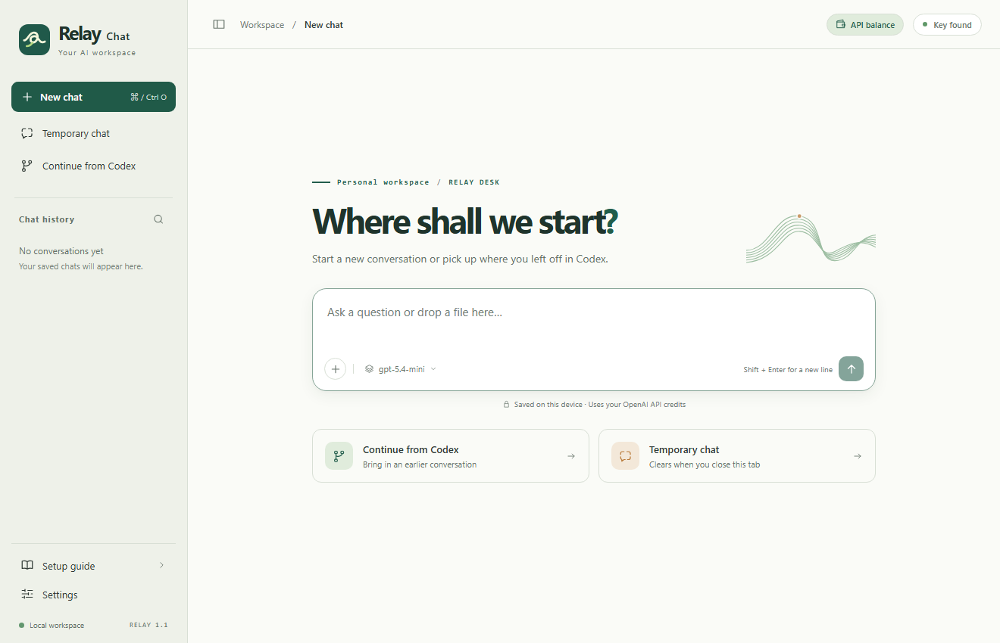

# Relay Chat

Relay is a local chat app for Windows and macOS. Use your own OpenAI API key to chat, work with files, or continue a conversation from Codex. Saved chats live on your device. A temporary chat clears when you refresh or close its tab.



## Download

| Computer | Download | Open after extracting the ZIP |
| --- | --- | --- |
| Windows x64 | [Windows desktop app](https://github.com/D-K-Deng/relay-chat/releases/latest/download/RelayChat-Windows-x64.zip) | `RelayChat.exe` |
| Mac with Apple silicon | [Apple silicon desktop app](https://github.com/D-K-Deng/relay-chat/releases/latest/download/RelayChat-macOS-AppleSilicon.zip) | `RelayChat.app` |
| Mac with an Intel processor | [Intel desktop app](https://github.com/D-K-Deng/relay-chat/releases/latest/download/RelayChat-macOS-Intel.zip) | `RelayChat.app` |

All three downloads include Python. The Mac packages target macOS 11 or later. Use a current browser. To identify your Mac, open the Apple menu and choose **About This Mac**. The [release page](https://github.com/D-K-Deng/relay-chat/releases/latest) also includes the source.

## First run

1. **Claim your credits.** If your subscription qualifies, link it to an API organization you own. Check the credited amount, expiry date, and organization in Billing. The published benefit covers eligible paid Pro and Business subscriptions. [OpenAI eligibility and claim instructions](https://developers.openai.com/api/docs/guides/chatgpt-api-credits)
2. **Connect your own key.** Open the extracted folder or cloned repository in Codex, enable the OpenAI Developers plugin, and send the instruction below. Select a project in the organization that received the credits.
3. **Open Relay.** Double-click the app and send your first message. To track your credits, click **API balance** in the top bar and enter the current USD balance from OpenAI Billing. The header updates after Relay receives usage for each response.

> Read README.md and web/prompt.txt. Follow the prompt to configure and start Relay Chat on this computer using my OpenAI account.

The [illustrated setup guide](docs/GETTING_STARTED.md) covers manual key setup, macOS first launch, and troubleshooting. The complete [Codex setup prompt](web/prompt.txt) is included with every desktop download.

## Daily use

| Task | How |
| --- | --- |
| Keep a conversation | Choose **New chat**. Search history by title or message. Open the chat menu to rename, pin, delete, or export it to Markdown. |
| Chat temporarily | Choose **Temporary chat**. You can switch away and return within the same tab. Refreshing or closing the tab clears its messages and attachments. |
| Continue from Codex | Choose **Continue from Codex**, select a local session, JSONL file, or pasted notes, then preview the messages to keep. Sending your next question passes the selected recent context to OpenAI. |
| Add files | Use the plus button, drag in a file, or paste a screenshot. Each message supports up to four text, code, PNG, JPEG, WebP, or GIF attachments. |
| Control usage | Click the model name to set a model, context length, output limit, and custom instructions. The defaults are `gpt-5.4-mini`, 32 messages, and 4,096 output tokens. |
| Stop or retry | Use the stop button during generation. **Regenerate** issues a new request for the last question and replaces that reply. Generated tokens can incur charges. |
| Check your balance | **API balance** shows the estimate for this device and links to the official organization balance. The estimate includes tracked temporary chats. |
 
Enter sends a message. Shift+Enter inserts a line break. Ctrl/Cmd+K searches history. Ctrl/Cmd+O opens a new chat.

## Credits and privacy

**The header shows a local estimate.** Set its starting amount from OpenAI Billing. Relay subtracts estimated costs using the input, cached input, and output tokens reported for each response. Opening the app or checking the estimate makes no paid API call. Reconcile the amount after spending in another app, switching organizations, receiving a grant, or reaching its expiry. A response with missing usage or unsupported pricing leaves a visible gap. The balance panel links directly to the official figure. [OpenAI Billing](https://platform.openai.com/settings/organization/billing/overview) · [API pricing](https://developers.openai.com/api/docs/pricing)

OpenAI applies eligible free credits before purchased credits. If your organization has a purchased balance, requests can continue after the grant is exhausted. ChatGPT and signed-in Codex usage limits are separate. [OpenAI credit rules](https://developers.openai.com/api/docs/guides/chatgpt-api-credits)

The local service listens on loopback. The Python backend reads `.env.local` next to the README, then checks the `OPENAI_API_KEY` environment variable. It sends model requests to the official Responses endpoint. Both chat modes use `store: false`. Temporary message content stays out of the chat database. When tracking is enabled, Relay keeps aggregate spending counters for both modes. [OpenAI API data controls](https://developers.openai.com/api/docs/guides/your-data)

Codex imports are snapshots of visible text. Importing leaves the original session intact. To discuss current files, attach them to a message. Markdown exports contain message text and attachment names.

| System | Local data |
| --- | --- |
| Windows | `%LOCALAPPDATA%/RelayChat` |
| macOS | `~/Library/Application Support/RelayChat` |
| Linux | `$XDG_DATA_HOME/RelayChat` or `~/.local/share/RelayChat` |

Set `RELAY_DATA_DIR` to choose a different data folder. To back up saved conversations and settings, quit the service and copy that folder.

## Run from source

```sh
git clone https://github.com/D-K-Deng/relay-chat.git
cd relay-chat
```

Install Python 3.10 or later. On Windows, double-click `Start.cmd` or run `py -3 app.py`. On macOS, double-click `Start.command` or run `python3 app.py`. Linux supports `python3 app.py`. Run `git pull` for updates.

```sh
python app.py --doctor              # Local setup status
python app.py --no-open             # Start without opening a window
python app.py --browser --port 8422 # Choose a browser tab and another port
python app.py --test-api            # Optional: one small billable API request
python -m unittest discover -s tests -v
```

The default address is [127.0.0.1:8421](http://127.0.0.1:8421). Use **Settings → Quit local service** or press Ctrl+C in the launch terminal to stop it.

## Build a release

On Windows, install PyInstaller and run `py -3 scripts/build_windows.py`. On a Mac with the Xcode Command Line Tools, run `python3 scripts/build_macos.py` to build both Mac packages. Use `--arch arm64` or `--arch x86_64` to build one architecture. Cross-builds can select a Zig compiler with `--zig`. The Mac packages include [Astral's portable CPython runtime](https://github.com/astral-sh/python-build-standalone/releases/tag/20261026).

The **Desktop packages** GitHub Actions workflow builds from source, exercises each extracted package on its native platform, and uploads the resulting ZIP files. Pushing a version tag such as `v1.1.0` publishes the tested packages to GitHub Releases. Local builds write to `dist/`.
