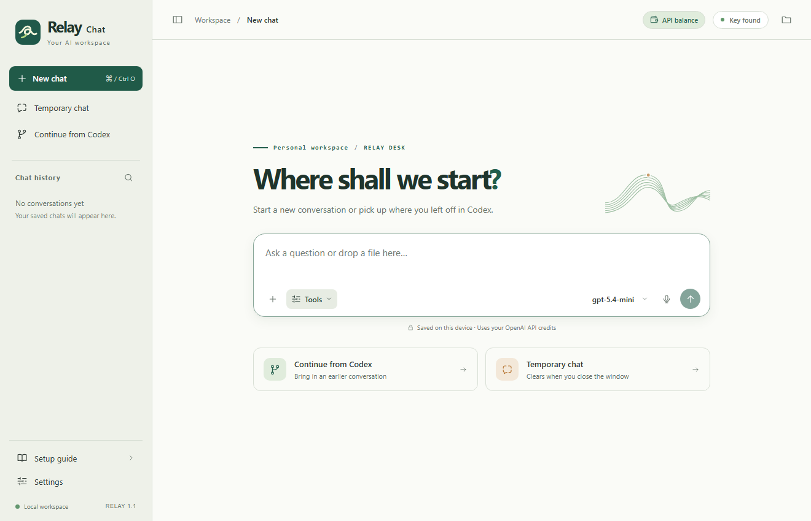

# Relay Chat

Relay is a desktop chat app for Windows and macOS. Use your OpenAI API key to ask questions, work on a local project, or continue a conversation from Codex. Saved chats live on your device. Temporary chats clear when you reload or close the window.



## Download

| Computer | Download | Open after extracting the ZIP |
| --- | --- | --- |
| Windows x64 | [Windows desktop app](https://github.com/D-K-Deng/relay-chat/releases/latest/download/RelayChat-Windows-x64.zip) | `RelayChat.exe` |
| Mac with Apple silicon | [Apple silicon desktop app](https://github.com/D-K-Deng/relay-chat/releases/latest/download/RelayChat-macOS-AppleSilicon.zip) | `RelayChat.app` |
| Mac with an Intel processor | [Intel desktop app](https://github.com/D-K-Deng/relay-chat/releases/latest/download/RelayChat-macOS-Intel.zip) | `RelayChat.app` |

The links above point to the latest published release. This checkout opens its own desktop window on both platforms. The Windows package bundles Qt WebEngine and Python. The Mac packages include Python and display the interface in an AppKit window using the WebKit framework supplied with macOS. To identify your Mac, open the Apple menu and choose **About This Mac**.

## First run

1. **Claim your credits.** If your subscription qualifies, link it to an API organization you own. Check the credited amount, expiry date, and organization in Billing. The published benefit covers eligible paid Pro and Business subscriptions. [OpenAI eligibility and claim instructions](https://developers.openai.com/api/docs/guides/chatgpt-api-credits)
2. **Connect your own key.** Open the extracted folder or cloned repository in Codex, enable the OpenAI Developers plugin, and send the instruction below. Select a project in the organization that received the credits.
3. **Open Relay.** Double-click the app and send your first message. To track your credits, click **API balance** in the top bar and enter the current USD balance from OpenAI Billing. The header updates as Relay accounts for each request.

> Read README.md and web/prompt.txt. Follow the prompt to configure and start Relay Chat on this computer using my OpenAI account.

The [illustrated setup guide](docs/GETTING_STARTED.md) covers manual key setup, macOS first launch, and troubleshooting. The complete [Codex setup prompt](web/prompt.txt) is included with every desktop download.

## Daily use

| Task | How |
| --- | --- |
| Keep a conversation | Choose **New chat**. Search history by title or message. Open the chat menu to rename, pin, delete, or export it to Markdown. |
| Run chats in parallel | Start a request, then open another chat and send a second request. Up to four chats can run in one window. The sidebar shows which chat is running, needs review, or finished while you were away. Open a chat to review a command, read its output, or stop its response. |
| Resume a draft | Relay saves unsent text on this device for each regular chat, including the **New chat** composer. Open the same chat after restarting to continue typing. Unsent attachments and temporary drafts stay in the current window. |
| Chat temporarily | Choose **Temporary chat**. You can switch away and return within the same window. Reloading or closing the window clears its messages and attachments. |
| Continue from Codex | Choose **Continue from Codex**, select a local session, JSONL file, or pasted notes, then preview the messages to keep. Sending your next question passes the selected recent context to OpenAI. |
| Work with files | Regular chats have their own folder for files Relay creates. To use an existing project, open **Tools**, choose the workspace folder, and select **Read files** or **Review edits**. |
| Review changes | **Auto Review** starts on in regular chats. A separate request to the selected model assesses eligible edits against your task. Low-risk edits can proceed automatically. Other changes show a diff with **Apply change** and **Decline**. **Workspace activity** records the decision and reason. |
| Run commands | **Terminal commands** starts on in regular chats. Try “Check my Git version.” In a project you can also ask Relay to run a test or build. Inspect the command and working directory, then select **Run command**. Output streams into the reply, and the activity history records the exit code. |
| Branch a conversation | Choose **Branch** beneath a saved reply to open a new chat with the conversation up to that point. Later messages and edits to the original conversation stay in the original chat. |
| Add files | Use the plus button, drag in a file, or paste a screenshot. Each message accepts up to four attachments. Supported models can read PDF text and page images. Each PDF or image can be up to 3 MiB. [File inputs](https://developers.openai.com/api/docs/guides/file-inputs) |
| Switch the interface language | Open **Settings → Language** and choose **English** or **简体中文**. Relay remembers the choice on this device. |
| Find a result | Click the file card under a reply or the folder icon in the top bar. Preview text, images and tables, save a copy, or reveal a saved output in its folder. Saved chats keep copies of the files Relay creates or edits. Files from earlier versions remain available in their original chats. Temporary chat copies stay in the window until you save them. |
| Update a running task | On a supported GPT-6 live connection, type another requirement and choose **Send update** or press Enter. For example, “Use the Mac layout for the remaining changes.” Completed edits stay on disk. **Stop** remains available. [Mid-turn steering](https://developers.openai.com/api/docs/guides/steering) |
| Continue a long conversation | Use **Settings → Conversation context → Automatic**. On compatible models, Relay keeps a compacted checkpoint for later turns. The composer shows context usage and indicates when a checkpoint was used. Your full transcript stays available in the chat. [Compaction](https://developers.openai.com/api/docs/guides/compaction) |
| Dictate a draft | Hold the microphone button, speak, and release to transcribe. Edit the text before sending. Escape cancels recording. Audio is sent to OpenAI for transcription and the recording stays in memory. [Transcription](https://developers.openai.com/api/docs/guides/speech-to-text) |
| Choose a model | Click the model name under the message box to choose a **Model**, **Effort**, or **Speed**. Relay loads compatible chat models from your API project and shows the options each model supports. **Auto** uses the model's default effort, while **Standard** uses standard API processing. [OpenAI processing tiers](https://developers.openai.com/api/docs/pricing) |
| Search the web | **Search** starts on for compatible models. Open **Tools → Web search** to change it. Replies that use web search include clickable citations. Searches can incur additional API charges. [Web search](https://developers.openai.com/api/docs/guides/tools-web-search) |
| Use subagents | Select **Effort → Ultra** on a compatible model. When the model delegates work, click a subagent’s name to open its activity panel and follow its streamed messages and tool activity. You can reopen the panel from a saved reply. Delegation can increase token usage. **Speed → Ultrafast** controls processing speed separately. [Codex model guide](https://developers.openai.com/codex/models) · [Multi-agent API](https://developers.openai.com/api/docs/guides/responses-multi-agent) |
| See a reasoning summary | Enable **Show reasoning summaries** in **Settings** for a supported single-agent reasoning mode. Expand **Reasoning summary** above the answer when the API provides one. The reply footer includes reported cached input and reasoning token counts. [Reasoning guide](https://developers.openai.com/api/docs/guides/reasoning) |
| Set response preferences | Relay responds in the language of your request by default. Add standing preferences in **Settings → Custom instructions**. |
| Control usage | **Settings** includes conversation context, an optional output cap, and custom instructions. Automatic context follows the Codex model budget when available and keeps the newest messages that fit. By default, the model determines the output limit. |
| Stop or retry | Use the stop button during generation. **Regenerate** issues a new request for the last question and replaces that reply. Generated tokens can incur charges. |
| Check your balance | **API balance** shows the estimate for this device and links to the official organization balance. The estimate includes tracked temporary chats. |
 
Model, Effort, Speed, and Search are saved automatically on this device. New chats and subsequent launches use the saved choices. Search pauses on incompatible models or effort levels and resumes on compatible ones if enabled. Changing **Auto Review** or **Terminal commands** in a regular chat updates that chat and the starting preference for future chats. Other saved chats keep their own choices.

Enter sends a message. Shift+Enter inserts a line break. Ctrl/Cmd+K searches history. Ctrl/Cmd+O opens a new chat.

## Credits and privacy

**The header shows a local estimate.** Set its starting amount from OpenAI Billing. Relay prices reported usage even when a request fails. If generation stops before a full usage report arrives, Relay estimates tokens from the request and observed output and labels that portion of the spend. A rejection before generation with no reported usage adds to the failed-request count only. Requests with unknown usage or pricing are flagged for reconciliation. Opening the balance panel is free. Use Billing to reconcile usage from other apps, grants and their expiry. [OpenAI Billing](https://platform.openai.com/settings/organization/billing/overview) · [API pricing](https://developers.openai.com/api/docs/pricing)

OpenAI applies eligible free credits before purchased credits. If your organization has a purchased balance, requests can continue after the grant is exhausted. ChatGPT and signed-in Codex usage limits are separate. [OpenAI credit rules](https://developers.openai.com/api/docs/guides/chatgpt-api-credits)

The local service listens on loopback. The Python backend reads `.env.local` next to the README, then checks the `OPENAI_API_KEY` environment variable. It sends model requests to the official Responses endpoint. Both chat modes use `store: false`. Temporary message content stays out of the chat database. When tracking is enabled, Relay keeps aggregate spending counters for both modes. [OpenAI API data controls](https://developers.openai.com/api/docs/guides/your-data)

Regular chats use separate folders under `chat-workspaces` in Relay’s local data directory. **Manage chat → Delete chat** shows the full path before removing a chat folder and everything inside it. Clear that option to keep the folder. Relay keeps folders shared with a selected project. If other chats branched from this one, their file cards keep their own copies.

For a project you selected yourself, the deletion dialog lists files Relay tracked creating in that chat. Select the project cleanup option to remove those files and any empty folders created with them. Files edited elsewhere, earlier untracked project files, exports you saved separately, and files created by commands outside the chat folder stay at their locations.

Temporary chats, Codex imports, and branches start with local tools off. Each saved chat remembers the folder and access level you choose. A workspace turn sends relevant filenames and requested excerpts to your API project. The local tools search UTF-8 text, read numbered lines, create files and replace matching text. Dotfiles, linked paths, and common dependency and build directories are skipped. A saved reply keeps an activity list and applied diffs. An applied file edit remains on disk when you close a temporary chat. Markdown exports contain message text and attachment names.

**Terminal commands** start in the chat folder, the selected project, or a subfolder. Relay passes separate arguments to installed tools. Examples include `python -m unittest discover -s tests`, `python -m pytest`, `npm test`, `npm run build`, `cargo test`, and `go test ./...`. Python commands prefer the project's `.venv`. Install the relevant development tools and project dependencies on the machine running Relay. Tests and builds run under your OS account and can change files. Each one requires your approval, including when Auto Review is on. Terminal output is returned to the model and is retained in saved chats. Commands have a two-minute time limit and return up to 24 KB of combined output. The stop button interrupts a running command.

The workspace loop follows the Responses function-calling protocol. A workspace turn includes up to 8,000 characters of the root `AGENTS.md` when present. Relay sends tool results back to the model until it answers, you stop the turn, or it uses its 16 rounds of tools. Each upstream request contributes separately to the credit estimate. Automatic file reviews run with standard API processing and receive the current user request, file path, proposed action, and diff. Eligible read-only Git queries use a local rule. [OpenAI function calling](https://developers.openai.com/api/docs/guides/function-calling) · [Inside the Codex harness](https://openai.com/index/unlocking-the-codex-harness/)

| System | Local data |
| --- | --- |
| Windows | `%LOCALAPPDATA%/RelayChat` |
| macOS | `~/Library/Application Support/RelayChat` |
| Linux | `$XDG_DATA_HOME/RelayChat` or `~/.local/share/RelayChat` |

Set `RELAY_DATA_DIR` to choose a different data folder. To back up saved conversations and settings, quit the service and copy that folder.

## Run from source

```sh
git clone https://github.com/D-K-Deng/relay-chat.git
cd relay-chat
```

For a desktop checkout, use Python 3.12. On Windows, run `py -3.12 -m pip install -r requirements-desktop.txt`, then launch `py -3.12 app.py`. On macOS 13 or later, install the same requirements with `python3 -m pip install -r requirements-desktop.txt` and run `python3 app.py`. The included `Start.cmd` and `Start.command` launchers use the system Python. Linux supports the local web interface with `python3 app.py --browser`.

```sh
python app.py --doctor              # Local setup status
python app.py --no-open             # Start without opening a window
python app.py --browser --port 8422 # Choose a browser tab and another port
python app.py --test-api            # Optional: one small billable API request
python -m unittest discover -s tests -v
```

The default address is [127.0.0.1:8421](http://127.0.0.1:8421). Closing the desktop window that started the service stops it. Minimizing the window keeps it running. For a browser tab or a terminal launch with `--no-open`, use **Settings → Quit local service** or Ctrl+C in the launch terminal.

## Build a release

On Windows, install the build and desktop dependencies with `py -3.12 -m pip install "pyinstaller>=6.20,<7" -r requirements-desktop.txt`, then run `py -3.12 scripts/build_windows.py`. Keep `RelayChat.exe` and the adjacent `_internal` folder together. On a Mac with the Xcode Command Line Tools, run `python3 scripts/build_macos.py` to build both Mac packages. Use `--arch arm64` or `--arch x86_64` to build one architecture. Cross-builds can select a Zig compiler with `--zig`. The Mac packages include [Astral's portable CPython runtime](https://github.com/astral-sh/python-build-standalone/releases/tag/20261026).

The **Desktop packages** GitHub Actions workflow builds from source, exercises each extracted package on its native platform, and uploads the resulting ZIP files. Pushing a version tag such as `v1.1.0` publishes the tested packages to GitHub Releases. Local builds write to `dist/`.

Windows shortcuts can continue to point to `dist/RelayChat.exe` after each local build. If the existing app is open, the update waits for it to exit before replacing the executable and its runtime. Double-click `dist/Open Relay Chat.cmd` in the checkout to apply a pending build and start Relay.
