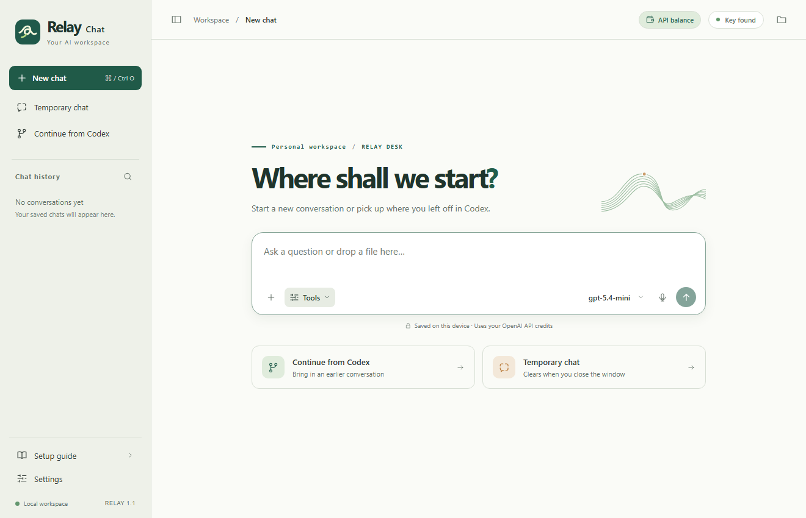
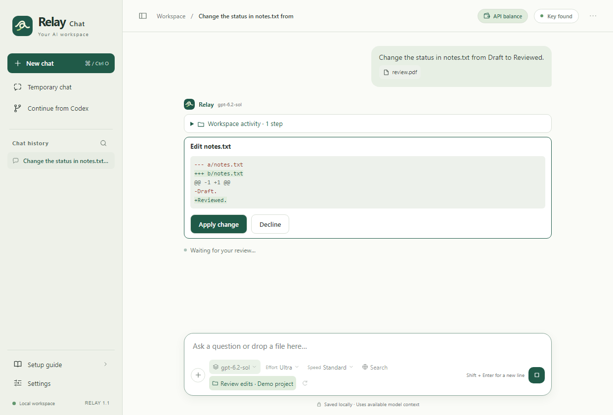
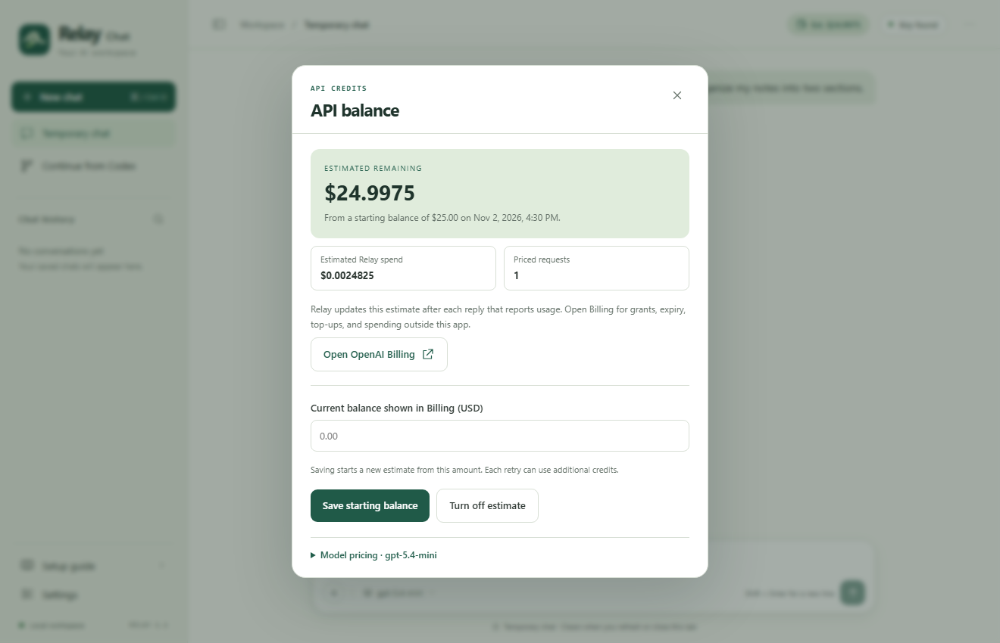
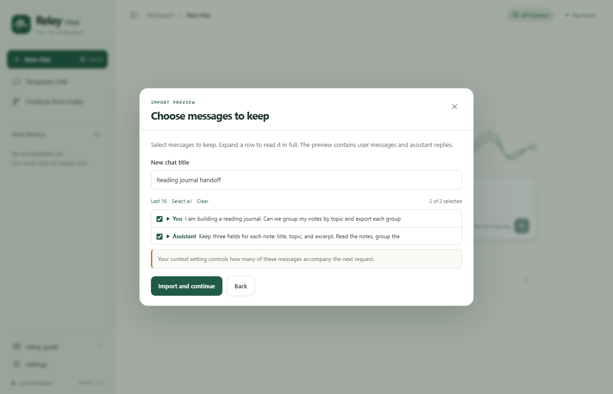

# From a credit grant to your first chat

Use the API organization that received your credits when you create a key. A working key for a different organization can charge that organization instead.

## 1. Claim the credits

OpenAI's published benefit covers eligible paid ChatGPT Pro subscriptions and Business workspaces that are at least seven days old. You must own the subscription or workspace and the receiving API organization, with the same email address on both accounts. Check the current requirements for your account. [Official credit guide](https://developers.openai.com/api/docs/guides/chatgpt-api-credits)

1. Sign in to the account that owns the subscription. For Pro, open **Settings → Billing** in ChatGPT. For Business, open workspace billing.
2. Find the **API credits** benefit. Select the API organization you own and confirm. You can also start in API Platform Billing.
3. Open Billing for the receiving organization. Record the amount granted, the remaining balance, and the expiry date. The first grant can be prorated for the remaining subscription period. Business grants depend on paid seats and billing cadence. [Organization billing](https://platform.openai.com/settings/organization/billing/overview)

If you already claimed the benefit, go straight to the receiving organization's billing page.

## 2. Get Relay and connect your key

Download the desktop ZIP for your computer and extract the whole folder. Each package includes Python. [Downloads](https://github.com/D-K-Deng/relay-chat/releases/latest)

- **Windows x64.** Choose `RelayChat-Windows-x64.zip`. Extract the whole folder and open `RelayChat.exe`. The desktop build from this checkout includes its Qt rendering engine.
- **Mac.** On macOS 13 or later, open **Apple menu → About This Mac**. An Apple M-series chip uses `RelayChat-macOS-AppleSilicon.zip`. An Intel processor uses `RelayChat-macOS-Intel.zip`. Extract the ZIP on the Mac using Finder. Keep the whole folder in the location you intend to use.
- **Source checkout.** Clone `https://github.com/D-K-Deng/relay-chat.git` and install Python 3.12. In the checkout, run `py -3.12 -m pip install -r requirements-desktop.txt` on Windows or `python3 -m pip install -r requirements-desktop.txt` on macOS. [Python downloads](https://www.python.org/downloads/)

Open the folder containing `README.md` and `web/prompt.txt` in Codex. Enable the OpenAI Developers plugin and connect OpenAI Platform when prompted. Send this message in Codex:

> Read README.md and web/prompt.txt. Follow the prompt to configure and start Relay Chat on this computer using my OpenAI account.

Codex checks whether a key is present. If you choose to create one, select a project in the organization that received your credits and confirm the local destination. A live connection test sends one small, billable request. You can open the app first and test later.

### Manual key setup

Create a project API key with permission to call the Responses API. Select the intended organization and project before creating it. [OpenAI API keys](https://platform.openai.com/api-keys)

Copy `.env.example` to `.env.local` next to the README. Open the copy in a local text editor, put the key after `OPENAI_API_KEY=`, and save. On Windows, check that the filename does not end in `.txt`. You can also launch Relay from a terminal that has `OPENAI_API_KEY` set. A nonempty value in `.env.local` takes precedence.

For the Mac desktop package, run `./Start.command --doctor` from the extracted folder once. It remembers the setup folder for launches from Finder. If you move that folder later, run the command again from its new location.

## 3. Start a conversation

On Windows, double-click `RelayChat.exe` to open the Relay Chat window. Closing it stops the local service. Minimizing it keeps the service running.

On macOS, double-click `RelayChat.app` to open its desktop window. Relay uses the WebKit framework built into macOS. You can also visit the [local workspace](http://127.0.0.1:8421) while Relay is running.

The Mac packages are distributed without Apple Developer ID notarization. If macOS asks about the developer on first launch, confirm that you trust the download and follow Apple's instructions for opening an app in **System Settings → Privacy & Security**. [Apple's first-launch instructions](https://support.apple.com/en-us/102445)

**Key found** means Relay can read a local key. Click the model name under the message box to change the model, **Effort**, or **Speed**. The neighboring **Tools** menu contains **Web search**, **Auto Review**, **Terminal commands**, and workspace access. **Search** starts on for compatible models. Replies that use web search include clickable citations. If a reply reaches its output limit, use **Continue** to keep going in the same chat.

Open **Settings → Language** to choose **English** or **简体中文**. The interface updates immediately. Your messages and imported conversations keep their original wording.

Relay remembers your **Model**, **Effort**, **Speed**, and **Search** choices on this device when you change them in the composer. They apply to new chats and return when you reopen the app. If a model or effort cannot search, Relay pauses Search until you select a compatible combination.

Hold the microphone next to the attachment button to dictate. Release it to put the transcription in your draft, then edit and send. On first use, allow microphone access when your desktop asks.

You can leave one chat running while you work in another. When a chat shows **Needs review** in the sidebar, open it to see the proposed change or command. You can switch away again while the command runs. **Stop** applies to the chat you are viewing.

Relay saves unsent text, including transcribed text, in each regular chat on this device. After restarting, choose the same chat in the sidebar, or **New chat** for a draft you started before its first message. Unsent attachments and temporary chat drafts stay in the current window.

To preview or export a file Relay created, open its card below the reply or the folder button in the top bar. You can also open files saved with earlier versions.

While a supported GPT-6 response is running, **Send update** adds a requirement to that task. To continue a long conversation over multiple launches, leave conversation context on **Automatic**. The context indicator shows when Relay has compacted earlier turns. You can still scroll back through the original messages.

For a task with independent pieces, open **Effort → Ultra** on a supported model such as GPT-6.2 Sol or Astra. Click a participating subagent’s name to see the messages and tool activity it streams. Reopen the same panel from the saved reply to review its activity later. Subagent work uses additional tokens. [Multi-agent API](https://developers.openai.com/api/docs/guides/responses-multi-agent)

In a regular chat, **Auto Review** and **Terminal commands** start on. Try “Create a file named notes.txt with my meeting agenda” or “Check my Git version.” Each regular chat has its own folder. Open **Tools** and select the workspace to see its path or choose a project on your computer. Changing either switch also sets your preference for future regular chats.

To work in an existing project, choose its folder and select **Read files** or **Review edits**. For example, ask “Find where the app sets its default model and show me the file and line.” For changes that need your review, inspect the diff and choose **Apply change** or **Decline**. Expand **Workspace activity** to review completed steps.

With **Auto Review** on, Relay sends eligible changes to an independent reviewer using the selected model. If it approves, the edit is applied and its reason appears under **Workspace activity**. If the reviewer needs your judgment or the review request fails, the usual diff appears. A review request uses API tokens. Switch **Auto Review** off to review each change yourself.

With **Terminal commands** on, try “Show the current Git branch” in a project with **Read files** access. In **Review edits**, try “Run this project's Python tests and summarize any failures.” Check the command and working directory before selecting **Run command**. Tests and builds run with your OS user permissions and always ask first. Read the live output below the command, use **Stop** to interrupt it, and expand **Workspace activity** to see the exit code later.

## 4. Check remaining credits

Click **API balance** in the top bar. Use **Open OpenAI Billing**, select the organization used by this key, and enter its current remaining USD balance. A zero balance is valid.

Relay updates the header for saved and temporary chats. A failed request with reported usage counts at the reported model and speed, falling back to the requested settings when those fields are absent. If the stream ends after generation starts and token counts are missing, Relay uses the request and observed output to estimate usage. The panel shows those estimates separately, alongside the failed-request count and any requests it could not price. Deleting a conversation preserves the spending already recorded.

This is an estimate for Relay on this device. Other apps, other devices, expiring grants, and top-ups affect the official balance. Re-enter the current amount from Billing after one of those changes. [OpenAI Billing](https://platform.openai.com/settings/organization/billing/overview) · [Usage dashboard](https://platform.openai.com/usage)

## 5. Continue a Codex conversation

Choose **Continue from Codex** and select a local session. You can instead select a rollout JSONL file or paste handoff notes from another device. Try `examples/sample-rollout.jsonl` to see the import without making an API request.

Expand a message to read it, select the parts you want, and choose **Import and continue**. The next question carries the recent messages allowed by your context setting. Use **Workspace** to give this chat access to the current project, or attach individual files in the composer. Choose **Branch** under a saved reply to try another approach from that point.

## Troubleshooting

| What you see | What to do |
| --- | --- |
| Key missing or HTTP 401 | Check `.env.local` next to the README and use **Setup guide → Check local key**. Replace a revoked key. If using an environment variable, restart Relay from a terminal that has it. |
| HTTP 403 or an unavailable model | Choose a Responses model the project can access and check the key's permissions. |
| Temporary rate limit | **Settings → Automatically wait for temporary rate limits** is on by default. Relay waits in the background and resumes as capacity becomes available. Stop the reply at any time. If generation was interrupted, Relay keeps the partial answer and continues from the available results. A tool task identifies work still pending. [OpenAI rate limits](https://developers.openai.com/api/docs/guides/rate-limits) |
| Exhausted API credits | Check the organization's balance, expiry, and spending limits in Billing. [OpenAI Billing](https://platform.openai.com/settings/organization/billing/overview) |
| Context or output limit | Include fewer previous messages or shorten attachments. Increase the output limit or ask a follow-up for an incomplete answer. |
| No Codex sessions found | Relay reads `sessions` and `archived_sessions` under `CODEX_HOME` or `~/.codex`. Use a JSONL file or paste an excerpt for a session on another device. |
| Network error | Check access to `api.openai.com`. If a proxy is required, launch Relay from a terminal configured with `HTTPS_PROXY`. |
| Port in use | On Windows run `.\RelayChat.exe --port 8422`. On Mac run `./Start.command --port 8422`. Source users can append `--port 8422` to the normal launch command. |
