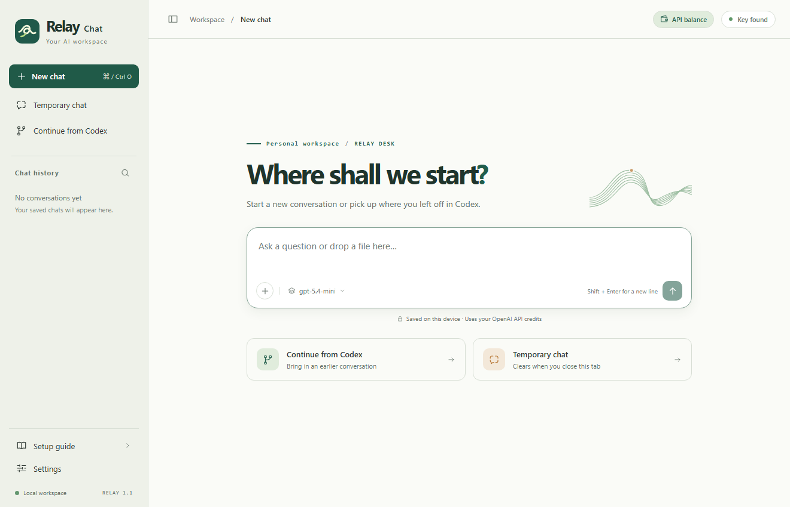
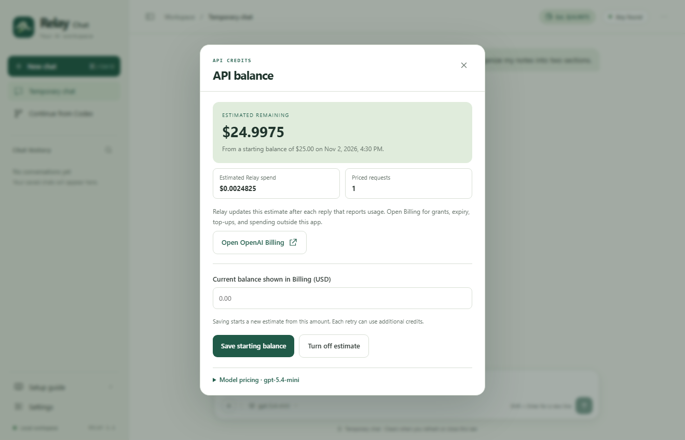
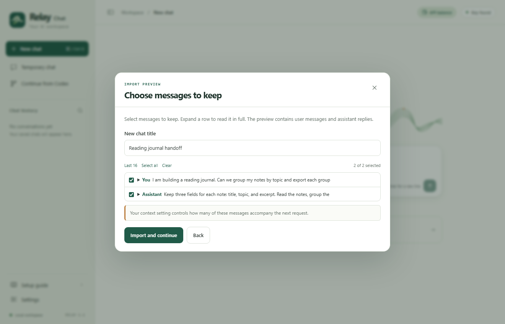

# From a credit grant to your first chat

Use the API organization that received your credits when you create a key. A working key for a different organization can charge that organization instead.

## 1. Claim the credits

OpenAI's published benefit covers eligible paid ChatGPT Pro subscriptions and Business workspaces that are at least seven days old. You must own the subscription or workspace and the receiving API organization, with the same email address on both accounts. Check the current requirements for your account. [Official credit guide](https://developers.openai.com/api/docs/guides/chatgpt-api-credits)

1. Sign in to the account that owns the subscription. For Pro, open **Settings → Billing** in ChatGPT. For Business, open workspace billing.
2. Find the **API credits** benefit. Select the API organization you own and confirm. You can also start in API Platform Billing.
3. Open Billing for the receiving organization. Record the amount granted, the remaining balance, and the expiry date. The first grant can be prorated for the remaining subscription period. Business grants depend on paid seats and billing cadence. [Organization billing](https://platform.openai.com/settings/organization/billing/overview)

If you already claimed the benefit, go straight to the receiving organization's billing page.

## 2. Get Relay and connect your key

Download the desktop ZIP for your computer and extract the whole folder. Each package includes its runtime. [Downloads](https://github.com/D-K-Deng/relay-chat/releases/latest)

- **Windows x64.** Choose `RelayChat-Windows-x64.zip`. Your app is `RelayChat.exe`.
- **Mac.** In **Apple menu → About This Mac**, an Apple M-series chip uses `RelayChat-macOS-AppleSilicon.zip`. An Intel processor uses `RelayChat-macOS-Intel.zip`. Extract the ZIP on the Mac using Finder. Keep the whole folder in the location you intend to use.
- **Source checkout.** Clone `https://github.com/D-K-Deng/relay-chat.git` and install Python 3.10 or later. The app itself uses the Python standard library. [Python downloads](https://www.python.org/downloads/)

Open the folder containing `README.md` and `web/prompt.txt` in Codex. Enable the OpenAI Developers plugin and connect OpenAI Platform when prompted. Send this message in Codex:

> Read README.md and web/prompt.txt. Follow the prompt to configure and start Relay Chat on this computer using my OpenAI account.

Codex checks whether a key is present. If you choose to create one, select a project in the organization that received your credits and confirm the local destination. A live connection test sends one small, billable request. You can open the app first and test later.

### Manual key setup

Create a project API key with permission to call the Responses API. Select the intended organization and project before creating it. [OpenAI API keys](https://platform.openai.com/api-keys)

Copy `.env.example` to `.env.local` next to the README. Open the copy in a local text editor, put the key after `OPENAI_API_KEY=`, and save. On Windows, check that the filename does not end in `.txt`. You can also launch Relay from a terminal that has `OPENAI_API_KEY` set. A nonempty value in `.env.local` takes precedence.

For the Mac desktop package, run `./Start.command --doctor` from the extracted folder once. It remembers the setup folder for launches from Finder. If you move that folder later, run the command again from its new location.

## 3. Start a conversation

Double-click `RelayChat.exe` on Windows or `RelayChat.app` on macOS. Chrome and Edge can open a separate app window. Relay otherwise opens your default browser. You can also visit the [local workspace](http://127.0.0.1:8421).

The Mac packages are distributed without Apple Developer ID notarization. If macOS asks about the developer on first launch, confirm that you trust the download and follow Apple's instructions for opening an app in **System Settings → Privacy & Security**. [Apple's first-launch instructions](https://support.apple.com/en-us/102445)

Try “Explain an API in one sentence.” **Key found** means Relay can read a local key. A completed response confirms that the project, model, and billing are working together.

## 4. Check remaining credits

Click **API balance** in the top bar. Use **Open OpenAI Billing**, select the organization used by this key, and enter its current remaining USD balance. A zero balance is valid.

As each Relay response finishes, the header updates using the reported token counts and the applicable standard model rates. Temporary chats also count toward spending, while their messages stay out of saved history. The panel shows when you set the starting balance and flags requests for which an estimate was unavailable.

This is an estimate for Relay on this device. Other apps, other devices, expiring grants, and top-ups affect the official balance. Re-enter the current amount from Billing after one of those changes. [OpenAI Billing](https://platform.openai.com/settings/organization/billing/overview) · [Usage dashboard](https://platform.openai.com/usage)

## 5. Continue a Codex conversation

Choose **Continue from Codex** and select a local session. You can instead select a rollout JSONL file or paste handoff notes from another device. Try `examples/sample-rollout.jsonl` to see the import without making an API request.

Expand a message to read it, select the parts you want, and choose **Import and continue**. The next question carries the recent messages allowed by your context setting. Attach any current source files the model needs. Commands, hidden reasoning, tool output, and file changes stay with the original Codex session.

## Troubleshooting

| What you see | What to do |
| --- | --- |
| Key missing or HTTP 401 | Check `.env.local` next to the README and use **Setup guide → Check local key**. Replace a revoked key. If using an environment variable, restart Relay from a terminal that has it. |
| HTTP 403 or an unavailable model | Choose a Responses model the project can access and check the key's permissions. |
| Rate limit | Wait briefly before using **Regenerate**. For exhausted credits, check the organization, expiry, and remaining balance in Billing. |
| Context or output limit | Include fewer previous messages or shorten attachments. Increase the output limit or ask a follow-up for an incomplete answer. |
| No Codex sessions found | Relay reads `sessions` and `archived_sessions` under `CODEX_HOME` or `~/.codex`. Use a JSONL file or paste an excerpt for a session on another device. |
| Network error | Check access to `api.openai.com`. If a proxy is required, launch Relay from a terminal configured with `HTTPS_PROXY`. |
| Port in use | On Windows run `.\RelayChat.exe --port 8422`. On Mac run `./Start.command --port 8422`. Source users can append `--port 8422` to the normal launch command. |
